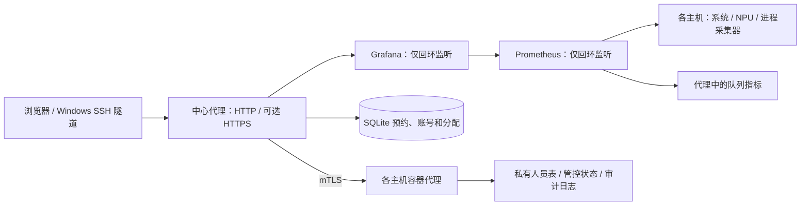

# 监控面板：功能、配置部署与优化记录

[English](monitoring-guide.md) · [仓库首页](../README.md)

本文对应 2026-11-04 的仓库源码。基础监控可以单独部署；下面的统一队列、人员白名单和持续拦截是按需启用的扩展。示例不包含实际服务器地址、人员名单或凭据。

## 1. 当前功能

| 模块 | 当前行为 |
| --- | --- |
| 资源监控 | 主机 CPU、内存、磁盘、共享存储、网络；逐卡 NPU 利用率、HBM、温度、功耗和采集状态 |
| NPU 进程 | 只展示 NPU Exporter 报告的进程，显示工号线索、姓名、容器、工作目录及宿主机映射目录 |
| 汇总与来源 | 按人、目录、主机和容器汇总；显示当前进程使用时长，以及有证据支持的作业来源 |
| 统一预约 | 两台各 8 卡的资源池；个人账号登录、申请、排队、分配、开始使用、取消和结束登记 |
| 人员白名单 | 仅 Grafana 管理员可搜索、添加、删除；同步两台主机，普通用户不能读取名单 |
| 持续拦截 | 明确启用后，管控有有效工号但未在人员表中匹配到姓名的 NPU 容器；白名单优先豁免 |
| 页面入口 | 默认主页和旧主页地址跳到同一规范地址，保留时间范围等参数；支持 Grafana 页面内导航 |
| 刷新 | 右上角可选 1、5、10、30 秒，默认 1 秒；统一队列跟随选择，关闭自动刷新时暂停轮询 |
| Windows 访问 | `Open-Monitor.cmd` 建立本机 SSH 隧道；已配置 HTTPS 时可选 `Open-Web.cmd`；附独立使用说明 |
| 排队管理 | 仅管理员可调高/调低等待优先级；使用超时标记并通知当前使用人和下一位 |
| 登记核对 | 进程未匹配使用登记时标记“疑似插队”并通知在线用户，仅提示，不自动 Stop |

页面刷新不是采集周期：资源抓取通常为 5 秒，进程采集默认 10 秒。姓名和来源依赖已配置的证据，不代表独立的企业身份认证。

### 统一队列规则

| 项目 | 规则 |
| --- | --- |
| 单机 | 任意可用机器，或指定其中一台；每台可选 1–8 卡 |
| 双机 | 合计 2、4、8、16 卡，分别按 1+1、2+2、4+4、8+8 分配 |
| 卡号 | 依据队列可用容量分配；每台申请 1–4 卡时位于同一四卡组 |
| 时长 | 默认 0 小时 30 分钟；分钟下拉框为 0、5、10……55，普通任务最长 2 小时 |
| 预约范围 | 新预约的开始及预计结束时间，不晚于提交当天的次日上午 09:00，按配置时区计算 |
| 分配确认 | 分配后最多 10 分钟内直接点击“开始使用”，无需二次弹窗；更早的预约边界仍有效 |
| 多次提醒 | 分配时及第 2、4、6、8、9 分钟提醒；需要页面保持打开、登录并允许桌面通知 |
| 超时 | 未开始则释放本次分配，预约向后顺延一位，保留原申请时间；不是移动到队尾 |
| 结束 | 用户先自行停掉任务，再确认“结束登记”；该按钮只释放预约，不停止进程或容器 |
| 每日清空 | 启用后每天 09:00 清空全部预约登记；账号和实际任务保留，原已登记容器的本次运行可继续 |

开始使用后仍显示原申请时间。等待资格和计时保存在服务端，刷新页面或重启代理不重置；过期的分配编号不能领取新的分配。多个相邻预约同时超时时作为一组让后一位先行，使每个超时预约后移一位；末尾没有下一位时保留其末尾位置。

预约是资源协调工具：按队列登记计算容量，不自动执行启动命令，也不对绕过队列启动的工作负载实施硬件隔离。已经开始的任务不会因领取超时或预计时长到期被停止。旧版独立队列和网页 Stop 属于另一工作流，见[旧版队列参考](../skills/ascend-resource-monitor/references/task-queue.md)。

### 四步使用

1. 连接内网或 VPN，完整解压访问包，双击 `Open-Monitor.cmd`；登录个人账号并验证桌面通知。
2. 选择机器、卡数和时长，加入队列；夜间长任务另选开始时间。
3. 收到分配通知后核对机器和卡号，10 分钟内点击“开始使用”，再自行启动任务。
4. 用完先停止服务器上的任务，再确认“结束登记”。

网页链接打不开时使用 CMD 隧道入口，保持命令窗口打开。SSH 登录、个人排队账号和 Grafana 管理员是三套不同的登录用途。

## 2. 架构与数据



典型扩展布局为代理监听回环 3000、Grafana 回环 3001、Prometheus 回环 9090；HTTPS 入口按需绑定明确的内网地址。端口应与部署配置一致，不直接暴露底层服务或 Docker 接口。

| 文件或配置 | 用途与保留要求 |
| --- | --- |
| `deployment.json` | 基础安装的节点、数据卷、端口、保留周期；不接受队列扩展字段 |
| `<base>/config/container-control/proxy.json` | Grafana 地址、节点代理、mTLS、规范主页、队列和可选 HTTPS |
| `<base>/config/container-control/agent.json` | 当前主机、mTLS、受保护容器及可选 guard 配置 |
| `<base>/config/process-owners.json` | `employee_names` 与其他人工映射；保持私有，不放入客户端包 |
| `<base>/data/task-queue/queue.db` | 个人账号哈希、会话、预约顺序、领取期限、分配编号；备份使用 SQLite backup |
| `<base>/data/container-guard/state.json` | 完整容器 ID 的管控标记与豁免；升级不得清空或重新初始化 |
| 证书、私钥、审计日志 | 仅保存在部署受限目录；客户端不携带服务器私钥或管理员密码 |

人员白名单的重复同名添加可安全重试，冲突姓名不会被覆盖；跨主机部分失败会明确返回。加入白名单后，历史管控标记仍保留，但从“容器管控 · 持续拦截”表中隐藏；移除豁免后可恢复管控。不会自动重启已停止的容器。

## 3. 配置与部署

### 基础监控

1. 从[示例配置](../examples/deployment.example.json)准备私有 `deployment.json`。选择已有独立挂载的数据卷、执行者目录、中心节点、内网 IP 和端口。
2. 按[部署参考](../skills/ascend-resource-monitor/references/deployment.md)检查架构、驱动、存储、空间和已存在服务。基础安装目录是 `<storage_root>/<executor_id>/ascend-monitor/<id>`；复用部署沿用其已确认路径。
3. 使用 Windows 向导，或在每台主机的执行者脚本目录运行 `deploy_node.py --probe`、`--install`。依赖清单来自 `assets/software.json`，离线文件也须验证 SHA-256。
4. 在中心节点运行 `--verify`，检查所有预期目标、NPU 数据、进程数据新鲜度、面板 UID 和数据源。

从仓库根目录构建向导：

```powershell
python skills/ascend-resource-monitor/scripts/build_windows_package.py --mode wizard --output dist
```

Windows 需要 PowerShell 5.1 和 OpenSSH Client，不需要 Python；主机需要 Python 3.9+、systemd、驱动及安装权限。硬件与组件版本应按[部署参考](../skills/ascend-resource-monitor/references/deployment.md)匹配，不把一次存量部署验证当作所有型号都适用。

### 统一队列、白名单与管控扩展

这些能力由已有中心代理和 mTLS 主机代理承载，基础向导不会自动开启。先依[容器控制参考](../skills/ascend-resource-monitor/references/container-control.md)准备服务用户、证书、受限目录和代理，再合并以下片段到**代理配置**；这不是完整的基础安装配置：

```json
{
  "dashboard_uid": "lab-monitor",
  "canonical_dashboard_path": "/d/lab-monitor/overview",
  "task_queue": {
    "unified_queue": true,
    "database": "/data/operator/ascend-monitor/lab-monitor/data/task-queue/queue.db",
    "timezone": "Asia/Shanghai",
    "metric_prefix": "ascend",
    "reservation_buffer_seconds": 600,
    "daily_reset": true,
    "monitor_processes": true,
    "prometheus_url": "http://127.0.0.1:9090",
    "process_metric_prefix": "ascend_process_"
  }
}
```

- 代理 `nodes` 必须对应两台各 8 卡主机，节点名与监控标签一致。规范地址必须属于同一 `dashboard_uid`。
- 安装当前 `assets/runtime/` 中的代理、队列、规划器和依赖模块，保持同一版本；按现有服务启动 `control_proxy.py --config .../proxy.json` 和各主机 `container_agent.py --config .../agent.json`。
- 用 `patch_dashboard.add_queue_home_panel(dashboard, nodes)` 接入统一首页。保留已有面板、数据源 UID、筛选器和控制链接；代理也适配新旧 Grafana 面板 API。
- 启用 `monitor_processes` 时，同时用 `patch_dashboard.add_registration_status(dashboard, prefix)` 增加进程表的“排队状态”列；使用队列指标前缀，并检查各节点 `*_queue_process_source_up`。核对依据为当前工号和机器登记；信息不明或采集过期时显示待核实，不停止容器。
- 按[人员表参考](../skills/ascend-resource-monitor/references/personnel-roster.md)安装名单模块。持续拦截需按[guard 参考](../skills/ascend-resource-monitor/references/container-guard.md)另行明确启用；先检查候选、保护范围和禁用状态。
- 队列指标由代理 `/a5-queue/metrics` 提供。两节点各三个采集目标再加队列时，通常应有 7 个目标；实际以配置为准。
- Grafana 设置 `[dashboards] min_refresh_interval = 1s`；面板 `refresh` 为 `1s`，`timepicker.refresh_intervals` 为 `1s/5s/10s/30s`。
- 进程采集器、Prometheus 查询和 guard 必须使用一致前缀。采集器默认 `ascend_`；既有自定义部署使用 `--metric-prefix <prefix>`，guard 使用对应的 `<prefix>_process_`。抓取健康不代表查询前缀正确。

NPU 利用率优先使用设备整体指标 `npu_chip_info_overall_utilization`，旧采集器没有时再回退到 AICore 指标。两者含义见[官方指标定义](https://github.com/Ascend/mind-cluster/blob/master/docs/zh/scheduling/06_api/00_npu_exporter/01_prometheus_metrics_api.md)，不能用 HBM 占用替代计算利用率。登记核对要求采集完整且新鲜，归属不明确时只提示待核实；团队可能另有协调，未登记标记不触发容器停止。

控制代理及账号权限详见[容器控制](../skills/ascend-resource-monitor/references/container-control.md)，HTTPS、Cookie、WebSocket 和证书配置详见[网页入口](../skills/ascend-resource-monitor/references/web-entry.md)。统一队列的开始/结束不调用旧版网页 Stop；不要混用两种队列的操作说明。

### 访问包

验证部署后生成客户端，示例地址须换成已验证的实际入口：

```powershell
python skills/ascend-resource-monitor/scripts/build_windows_package.py --mode client --config deployment.json --shared-url "https://monitor.example.internal:8443/d/lab-monitor/overview?refresh=1s" --output dist
```

`Open-Monitor.cmd` 复用同一面板路径和参数建立本机隧道；`Open-Web.cmd` 直接访问 HTTPS；`Install.cmd` 安装快捷方式。必须完整解压并保留配套 PowerShell/JSON 文件，不只发送一个 CMD。实际地址、离线 HTML 和个性化访问包留在私有交付目录。

## 4. 升级与回滚

1. 记录当前版本、服务名、配置路径、文件哈希与预期修改范围；备份要修改的源码和配置，并为队列数据库做一致性备份。
2. 保留账号、证书、人员表、管控状态、预约、端口和指标前缀。扩展部署不要直接用基础安装覆盖已有代理布局。
3. 成组更新互相依赖的模块，保持文件属主和权限，确认服务账户有读取及必要的数据目录写入权限。
4. 只重启改动涉及的监控组件；改 systemd 配置才需要 `daemon-reload`。不为验证而重启或停止业务容器。
5. 验证真实页面后再交付：默认主页与直接入口一致、四档刷新、权限、机器/卡数、时间边界、原申请时间、提醒与领取流程、白名单过滤、指标与所有预期目标。
6. 失败时先查原作业回执和日志，再恢复对应备份；不要盲目重试容器停止，不用旧数据库覆盖已经发生的新预约操作。

## 5. 本轮优化点

| 问题 | 改进 |
| --- | --- |
| 默认主页与新面板不一致、页面内导航丢排队区 | 规范主页跳转，统一新旧 API 和页面脚本加载 |
| 资源选项只支持少数组合 | 拆分机器与卡数，支持任意单机、指定单机及四种平均双机组合 |
| 时长只有小时不直观、远期预约无边界 | 小时＋5 分钟档位，保存次日 09:00 截止时间并约束排队及延迟领取 |
| 分配长期无人领取 | 服务端 10 分钟期限，多次通知，超时后移一位，旧分配编号失效 |
| 开始使用多一次弹窗、开始后申请时间消失 | 单击开始，保留原申请时间；取消和结束继续确认 |
| 白名单入口和管理员状态混乱 | 名单仅管理员可读写，移除重复登录入口，双机同步与冲突检查 |
| 白名单容器仍混在持续拦截表中 | 页面只显示仍被拦截的记录；后台保留历史标记 |
| 采集器更新导致管控和进程表无数据 | 可配置指标前缀，并校验实际查询返回的序列 |
| 刷新与访问方式不统一 | 默认 1 秒，四档刷新联动排队；CMD 为访问兜底，完整包和图文说明同步 |
| 使用超时不易察觉、等待顺序不可调整 | 当前使用人及下一位收到提醒，页面标记超时；管理员可调高/调低优先级 |
| 旧预约长期残留、默认时长不便 | 可选每天 09:00 清空登记但不影响任务，默认 0 小时 30 分钟 |
| AICore 指标导致总体利用率一直为零 | 优先使用设备整体利用率，按卡兼容旧采集器指标 |
| 未登记使用难发现 | 基于新鲜数据标记并通知在线用户，仅提示、不自动 Stop |

## 6. 验证范围

仓库检查使用 `python tools/check.py`，贡献提交运行规定范围的 `pre-commit`。本轮在已有双节点部署上验证页面、权限、入口及全部 7 个抓取目标；Linux 隔离套件最近一次为 177 项、3 项跳过。机器分配、10 分钟边界、顺延位置、服务重启保留计时、过期分配拒绝、提醒、无弹窗开始、每日清理边界、调序权限和进程数据新鲜度均通过隔离测试或浏览器夹具验证，没有为了测试停止生产业务，也不强制触发下一次生产环境 09:00 清理。

新服务器从零安装、其他硬件型号和不同公司的网络/证书策略仍需各自验收。未运行的测试不按通过报告。
