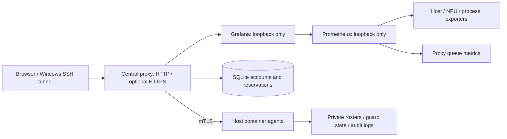

# Monitoring: capabilities, deployment and improvements

[Repository](https://github.com/LookAround0301/ascend-resource-monitor)

This guide describes the repository source as of 2026-11-04. Basic monitoring can run independently. The unified queue, personnel allowlist and persistent guard are separately enabled extensions. All configuration below is illustrative; real endpoints, rosters and credentials remain private.

## 1. Current capabilities

| Area | Behavior |
| --- | --- |
| Resource monitoring | Host CPU, RAM, disks, shared storage and networking; per-NPU utilization, HBM, temperature, power and collection health |
| NPU processes | Only processes reported by NPU Exporter, with employee evidence, optional name, container, working directory and host mount mapping |
| Summaries and origin | Group by person, directory, node and container; show current process duration and evidence-based job origin |
| Unified reservations | A pool of two eight-card nodes, with personal login, queuing, allocation, claiming, cancellation and completion |
| Personnel allowlist | Search/add/remove only for verified Grafana administrators, synchronized across host rosters |
| Persistent guard | When explicitly enabled, intercept NPU containers with a valid employee ID but no mapped name; allowlist exemptions take precedence |
| Navigation | One canonical homepage, including old-home redirects, preserved query parameters and Grafana client-side navigation |
| Refresh | 1/5/10/30-second choices, default 1 second; queue polling follows the choice and pauses when automatic refresh is Off |
| Queue operations | Administrator-only top/up/down waiting-priority adjustment, owner/next-user overdue notices and optional daily 09:00 reservation reset |
| Registration checks | Read-only process/queue matching, with unregistered-use annotations and online notifications; no automatic Stop |
| Windows access | `Open-Monitor.cmd` for a local SSH tunnel, optional `Open-Web.cmd` for verified HTTPS, and a separate user guide |

Page refresh is not sampling frequency: resource scraping is normally every five seconds and process collection every ten seconds. A displayed name or origin is evidence from configured sources, not independent corporate identity verification.

### Unified queue rules

| Setting | Rule |
| --- | --- |
| Single node | Any available node or one specified node, 1–8 cards |
| Two nodes | 2/4/8/16 cards in total, split 1+1 / 2+2 / 4+4 / 8+8 |
| Card placement | Use available queue capacity; requests for 1–4 cards per node stay in one four-card group |
| Duration | Defaults to 0 hours and 30 minutes; whole hours plus 0/5/10/…/55 minutes; normal tasks are at most two hours |
| Reservation horizon | New tasks must start and finish by 09:00 on the next calendar day in the configured timezone |
| Claiming | Click Start use directly within at most ten minutes of allocation; an earlier scheduling deadline still applies |
| Reminders | At allocation, then after 2, 4, 6, 8 and 9 minutes; keep the page open, signed in and notifications enabled |
| Unclaimed offer | Release that allocation and move back one waiting position, preserving the original application time |
| Completion | Stop the workload yourself, then confirm Finish registration; the button releases the reservation without stopping processes or containers |
| Daily reset | When enabled, clear all reservation records at 09:00 without stopping workloads; prior registered container instances can continue |

Application time remains visible after a task starts. Offer deadlines and order are persisted; reloads or proxy restarts do not reset them. A stale offer ID cannot claim a new allocation. Consecutive simultaneous misses pass the next reservation as one block, moving each missed reservation one position; a trailing reservation stays at the end when nobody follows it.

Reservations coordinate capacity recorded in the queue. They do not execute startup commands or enforce hardware isolation against workloads launched outside it. Active workloads are never stopped for a missed claim or estimated-duration expiry. The older independent-node queue and browser Stop workflow are described separately in the [legacy queue reference](task-queue.md).

### Four-step user workflow

1. Connect to the company network/VPN, extract the complete access package and run `Open-Monitor.cmd`. Sign into the personal queue account and verify notifications.
2. Choose machine, card count and duration; select a future start for a scheduled night task.
3. When allocated, check the machine/cards and click Start use within ten minutes, then launch the workload yourself.
4. Stop the workload yourself, then confirm Finish registration.

If the direct web link fails, use the CMD tunnel and leave its window open. SSH credentials, personal queue credentials and Grafana administrator credentials serve different purposes.

## 2. Architecture and state



A typical extended deployment uses proxy HTTP on loopback 3000, Grafana on loopback 3001 and Prometheus on loopback 9090. Optional HTTPS binds an explicitly selected intranet interface. Match the actual deployment configuration; do not expose underlying services or Docker.

| File/configuration | Purpose and retention |
| --- | --- |
| `deployment.json` | Base installer nodes, data volume, ports and retention; queue extension fields do not belong here |
| `<base>/config/container-control/proxy.json` | Grafana URL, node agents, mTLS, canonical home, queue and optional HTTPS |
| `<base>/config/container-control/agent.json` | Local node, mTLS, protected containers and optional guard |
| `<base>/config/process-owners.json` | `employee_names` and other owner mappings; keep private and out of client packages |
| `<base>/data/task-queue/queue.db` | Hashed accounts, sessions, order, claim deadlines and offer IDs; back up with SQLite backup |
| `<base>/data/container-guard/state.json` | Full-container-ID marks and exemptions; never reset it during an upgrade |
| Certificates, private keys and audit logs | Restricted deployment storage; no server private key or administrator password in access packages |

Allowlist retries with the same name are idempotent; conflicting names are rejected and partial cross-host failures are reported. Allowlisted historical guard marks remain stored but disappear from the active-interception table. Removing an exemption can restore enforcement. Allowlisting does not restart a stopped container.

## 3. Configuration and deployment

### Basic monitoring

1. Prepare a private `deployment.json` from the [example](deployment.md#configuration), choosing an existing mounted data volume, executor directory, central node, monitoring IPs and ports.
2. Follow the [deployment reference](deployment.md) to inspect architecture, drivers, mounts, free space and existing ownership. The base installer uses `<storage_root>/<executor_id>/ascend-monitor/<id>`; reuse a verified existing path for upgrades.
3. Use the Windows wizard, or run `deploy_node.py --probe` and `--install` from each host's executor-specific staging directory. Use `assets/software.json`; verify SHA-256 for offline packages too.
4. Run `--verify` centrally and check every expected target, NPU data, process freshness, dashboard UID and datasource.

Build the wizard from the repository root:

```powershell
python skills/ascend-resource-monitor/scripts/build_windows_package.py --mode wizard --output dist
```

Windows needs PowerShell 5.1 and OpenSSH Client, not Python. Hosts need Python 3.9+, systemd, working drivers and installation privileges. Match the hardware/software profile in the deployment reference rather than generalizing one existing installation to every device.

### Unified queue, allowlist and guard

These use the central proxy and mTLS host agents; the base wizard does not enable them automatically. First follow the [container-control reference](container-control.md) for service users, certificates and restricted directories. Merge this illustrative fragment into the **proxy configuration**, not the base installer's configuration:

```json
{
  "dashboard_uid": "lab-monitor",
  "canonical_dashboard_path": "/d/lab-monitor/overview",
  "task_queue": {
    "unified_queue": true,
    "database": "/data/operator/ascend-monitor/lab-monitor/data/task-queue/queue.db",
    "timezone": "Asia/Shanghai",
    "metric_prefix": "ascend",
    "reservation_buffer_seconds": 600,
    "daily_reset": true,
    "monitor_processes": true,
    "prometheus_url": "http://127.0.0.1:9090",
    "process_metric_prefix": "ascend_process_"
  }
}
```

- Configure exactly two eight-card nodes in the proxy's `nodes`, matching monitoring labels. The canonical path must belong to the same dashboard UID.
- Install matching versions of the proxy, queue, planner and dependencies from `assets/runtime/`. Run `control_proxy.py --config .../proxy.json` centrally and `container_agent.py --config .../agent.json` on each host under their established service accounts.
- Use `patch_dashboard.add_queue_home_panel(dashboard, nodes)` to add the unified region. Preserve existing panels, datasource UIDs, selectors and control links. The proxy supports both old and new Grafana dashboard APIs.
- With `monitor_processes` enabled, also apply `patch_dashboard.add_registration_status(dashboard, prefix)` to add the process table's registration-status column. Match the queue metric prefix and validate `*_queue_process_source_up` on every node. This is a read-only match of current employee/node registrations; ambiguous or stale evidence remains unverified, and no container is stopped.
- Install personnel modules per the [roster reference](personnel-roster.md). Enable automatic interception only under the separately authorized [guard procedure](container-guard.md), after reviewing candidates and protected workloads.
- Scrape queue metrics at `/a5-queue/metrics`. Two nodes with three exporters each plus queue metrics normally produce seven targets; the configured topology is authoritative.
- Set Grafana `[dashboards] min_refresh_interval = 1s`, dashboard `refresh` to `1s`, and `timepicker.refresh_intervals` to `1s/5s/10s/30s`.
- Keep process-exporter, Prometheus and guard prefixes aligned. The exporter defaults to `ascend_`; preserve a custom namespace with `--metric-prefix <prefix>` and matching guard `<prefix>_process_`. A healthy scrape does not prove query compatibility.

Use device-wide `npu_chip_info_overall_utilization` for the NPU headline and per-card usage when available, falling back to AICore utilization on older exporters. These are distinct metrics in the [official metric definition](https://github.com/Ascend/mind-cluster/blob/master/docs/zh/scheduling/06_api/00_npu_exporter/01_prometheus_metrics_api.md). AICore may report zero while device-wide usage is nonzero; HBM occupancy is not a substitute for compute usage.

See [control deployment](container-control.md) for permissions and [HTTPS entry](web-entry.md) for certificates, cookies and WebSockets. Unified Start/Finish does not invoke the legacy browser Stop workflow; keep their instructions separate.

### Access package

After verification, build the client with a verified shared URL if available:

```powershell
python skills/ascend-resource-monitor/scripts/build_windows_package.py --mode client --config deployment.json --shared-url "https://monitor.example.internal:8443/d/lab-monitor/overview?refresh=1s" --output dist
```

`Open-Monitor.cmd` uses the same dashboard path/query through a local tunnel; `Open-Web.cmd` opens HTTPS; `Install.cmd` creates a shortcut. Extract the full package and retain its PowerShell/JSON files instead of sending a lone CMD file. Real addresses, the deployment-specific HTML guide and personalized access packages remain in private handoff storage.

## 4. Upgrades and rollback

1. Record the revision, service names, paths, file hashes and intended changes. Back up changed code/configuration and create a consistent SQLite backup.
2. Preserve accounts, certificates, rosters, guard state, reservations, ports and metric namespaces. Do not run a baseline reinstall over an extended proxy layout.
3. Update dependent modules together and preserve file ownership, read permissions and the service's required writable data directories.
4. Restart only affected monitoring components; run `daemon-reload` only for changed unit definitions. Do not restart or stop business containers for verification.
5. Verify actual browser navigation, refresh choices, permissions, machine/card selection, time boundaries, application time, reminders/claims, allowlist filtering, queries and all expected targets before delivering access tools.
6. If a mutation fails, inspect its original receipt/logs, then restore the corresponding backups. Never blindly retry a container stop or overwrite newer reservation activity with an old database.

## 5. Improvements in this iteration

| Problem | Improvement |
| --- | --- |
| Divergent default/new homes and missing queue after client-side navigation | Canonical home redirects and queue loading across both dashboard APIs |
| Limited resource combinations | Separate machine/card selectors, automatic or fixed single-node placement, four balanced dual-node sizes |
| Awkward hour-only entry and unbounded future reservations | Five-minute choices and a persisted next-day 09:00 horizon that also constrains delayed claims |
| Allocations held without being claimed | Server-side ten-minute window, repeated reminders, one-position deferral and stale-offer rejection |
| Extra Start dialog and disappearing application time | Direct claim, preserved application time, retained cancellation/completion confirmation |
| Confusing allowlist/login flow | Administrator-only roster access, no redundant login link, cross-host synchronization and conflict checks |
| Exempt containers mixed into active interception | Filter the active table while retaining stored marks |
| Process/guard tables disappeared after collector updates | Configurable metric namespace and validation of actual returned series |
| Inconsistent polling/access instructions | One-second default, four refresh choices, CMD fallback and synchronized handoff documentation |
| Overdue use and rigid waiting order | Current/next-user notices, visible overdue status and administrator-only top/up/down priority adjustment |
| Stale daily reservations and awkward duration defaults | Optional 09:00 clearing without workload interruption; 0-hour/30-minute defaults |
| AICore-only headline remained zero | Prefer device-wide utilization, with per-card fallback for older exporters |
| Unregistered NPU use was hard to see | Fresh-source registration matching, informational status and online notices, with no automatic Stop |

## 6. Validation scope

Use `python tools/check.py` and the required commit-range `pre-commit` checks. This iteration verified an existing two-node deployment's pages, permissions, entry points and all seven scrape targets. The latest isolated Linux backend suite ran 178 tests with three skips. Allocation, claim expiry, exact queue movement, restart persistence, stale offers, reminders, direct claiming, daily-reset boundaries, priority authorization and process-source freshness were tested in isolation or with browser fixtures; production workloads were not stopped for testing. The next live 09:00 reset is not forced as an acceptance test.

Fresh-host installation, other hardware profiles and different corporate network/certificate policies still require their own acceptance checks. Skipped tests are not reported as passed.
